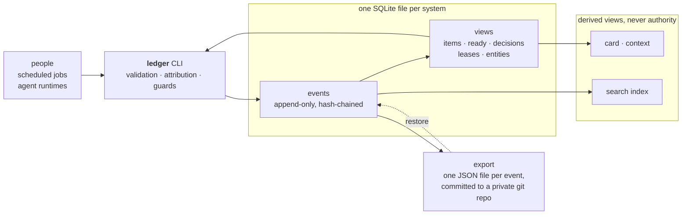

# ledger

[](LICENSE)

An append-only, hash-chained event log in one SQLite file, for the work items
of one body of work, the decisions made about them, and the words those
decisions rest on. One command, `ledger`, is the interface for people,
scripts and automated agents alike.

New here? [docs/start-here.md](docs/start-here.md) takes you from nothing to a
working ledger, one step at a time.

## Why

A body of work leaves two kinds of record. One kind is prose a person edits
over time: a design note, a standard, a decision record. Its change is read
as a diff, and git is the right home for it. The other kind is things that
happen or exist: a ticket was opened, a question was asked and then answered,
an item was claimed, a review returned its verdict, a decision was taken on
these words. That record is appended, not edited, and each line of it needs
to say what wrote it and what it rested on.

Most tools keep the second kind of record in the first kind's home. The
status table in a planning file, the decisions section at the bottom of a
document, the checklist in a ticket description: each is state written in
place, and each is rewritten by whoever touched it last. When the writers are
a person and several automated agents, that goes wrong quickly. Two sessions
edit one table and one of them loses. A decision is stored as a summary, and
by the time anyone asks what it rested on, the words are gone. A tracker, a
notes file and an agent's memory each hold a copy of the state, and none of
them knows which copy is right. A resume note written at the end of one
session reads as fact to the next, with nothing to separate what was verified
from what was hoped.

The ledger keeps the second kind of record the way it should be kept: as
events, appended once, chained by hash, each stamped with what wrote it.
Current state is derived from the events and never edited. A decision quotes
the words it rests on, and the quote is checked against them. Every fact has
one owner, and the views that show a fact name the events they were built
from. Prose stays prose, in git, and the ledger points at it.

What that looks like in practice:

- `note` and `state` append events; an item's status is a SQL view over its
  events, and a correction is one more event. Nothing in the `events` table
  is ever updated or deleted.
- `elect` refuses a quote that is not a byte-exact substring of the captured
  utterance it cites, and `lint-quotes` re-checks every election later.
- `card` renders a resume card that names the events it was built from and
  ends with "This card is a projection; the events are the authority".
- Every write refuses without `LEDGER_HARNESS`, so the log always says
  whether a shell, a scheduled job or an agent runtime wrote the line.
- One database holds one system's work, and the file itself records which
  system that is, so a work ledger and a personal one cannot be mixed by a
  wrong path.

None of this is new. [Built on](#built-on) says where the ideas came from.

## What this is

One SQLite file and one command. `ledger` has verbs that create
items, append notes, record questions, elections and decision records, claim
items with leases, render cards, search, export, back up and restore. It is
written against the Python standard library (3.11 or newer) with no runtime
dependencies, and it runs from a clone as `python3 -m ledger` or installs
with `pipx` as `ledger` ([Install](#install)).

The difference is in how it is built. Each promise the ledger makes is a
test: the tests live beside the code and run in CI on Python 3.11
and 3.12. The schema is a forward-only series of migrations that change
views and never rewrite an event, and tests open databases from older
versions to prove it. The package is vendored byte for byte into the
repositories that use it, each pinned to one commit and checking its copy
for drift, so there is one ledger rather than a family of forks. Every
change is reviewed before merge by a reviewer with no context of the build,
and code changes also by a second model family, with the guarded line
reverted and the test shown failing.

## How it fits together



The CLI is the only door. Writes land in the `events` table and nowhere
else; items, open questions, leases and decision records are SQL views over
it. Cards and the search index are built from the events and can be thrown
away. The export is the durable copy of the events: one canonical JSON file
per event, committed to a git repository of its own, and `restore` replays it
into a fresh database and checks the chain. A document stored by path
(`doc add --by-path`) is the exception: its event holds the path and digest,
not the bytes, which live only under the database's document root, so a
restore needs that directory copied beside the restored database.

## Install

You need Python 3.11 or newer. Its `sqlite3` module must carry the JSON
functions and FTS5, which the usual distributions do. For a walk from nothing
to a working ledger, in order, follow [docs/start-here.md](docs/start-here.md).

Install with [pipx](https://pipx.pypa.io/), which puts `ledger` on your `PATH`
in an environment of its own. There is no wrapper script to write and no
symlink to make:

```sh
pipx install git+https://github.com/smithadifd/ledger@vX.Y.Z
ledger --version
```

`vX.Y.Z` stands for a release tag; the repository's
[tags page](https://github.com/smithadifd/ledger/tags) lists them. Without
`@vX.Y.Z`, pipx installs the default branch.

To work on the ledger itself, install from a clone into a virtual
environment:

```sh
git clone https://github.com/smithadifd/ledger
cd ledger
python3 -m venv .venv
.venv/bin/python -m pip install .
.venv/bin/ledger --version
```

Do not run a bare `pip install` against the system Python: current macOS and
Homebrew Python refuse it (PEP 668, `externally-managed-environment`). From a
clone with nothing installed, `python3 -m ledger <verb>` is the same as
`ledger <verb>`.

## Upgrade

An install from a branch (or with no `@...` at all) upgrades in place:

```sh
pipx upgrade ledger
```

To move to a tag, install over the old one:

```sh
pipx install --force git+https://github.com/smithadifd/ledger@vX.Y.Z
```

An upgrade needs no other step: there is no wrapper to edit and no `PATH`
change. Check the result:

```sh
ledger --version
ledger doctor
```

`ledger --version` prints the installed version. `ledger doctor` reads the
database that `--db` or `LEDGER_DB` names and exits 0 when it opens. Your
database is not touched by the upgrade itself; the next write applies any
migration it lacks ([docs/migrations.md](docs/migrations.md)).

Moving across many releases at once, from 0.1.8 or older? Read
[docs/upgrading.md](docs/upgrading.md) first: it lists the four changes
that can stop a machine and the check to run for each.

## Quick start

```sh
mkdir -p /tmp/ledger-demo
export LEDGER_DB=/tmp/ledger-demo/ledger.db   # or pass --db on every call
export LEDGER_HARNESS=cli                     # required for writes: what is writing
export LEDGER_AGENT=me                        # optional: who is writing

ledger new --type ticket --title "Write the quick start" --id demo-1
ledger doctor
ledger note demo-1 --text "First draft of the quick start is done"
ledger append --item demo-1 --kind item.progress \
  --payload '{"text": "examples checked against a fresh database"}'
ledger card demo-1
ledger search draft
ledger verify
```

The first write creates the database and applies every migration. `doctor`
on a path that does not exist yet exits 1 (`database does not exist`); after
the first write it prints (`N` is the newest migration applied):

```text
path: /tmp/ledger-demo/ledger.db
schema_version: N
search: missing (ledger index rebuilds it)
```

`card` prints a bounded resume card for the item:

```text
# demo-1
revision: 3 <hash of event 3>
source_event_ids: 1, 2, 3
type: ticket
title: Write the quick start
status: open
...
## Notes
- event=2: First draft of the quick start is done

## Progress
- event=3: examples checked against a fresh database

This card is a projection; the events are the authority (ledger export-item -- demo-1)
```

`search` builds a derived full-text index (`search.db`, beside the database)
on first use and ranks matches with BM25. `verify` walks the hash chain and
re-validates every payload (`ok events=3`).

The ledger has no default database path: every call needs `--db` or
`LEDGER_DB`. The supported location for a real database is
`~/.local/share/ledger/<system>.db` (or whatever `LEDGER_DB` names). Keep
it out of git working trees (`index` and `search` refuse to build `search.db`
inside one, so the derived index is never committed) and out of synced
folders (the ledger refuses to open a database under iCloud, Dropbox,
OneDrive or Syncthing, because sync tools corrupt live SQLite files).

## The model

The ledger keeps a small number of promises. Each has a longer explanation in
[docs/concepts.md](docs/concepts.md).

**One ledger per system, and the system claim.** A *system* is one body of
work whose data must never mix with another's: say, a personal setup and an
employer's. Each system has its own database file, and the file itself
records which system it belongs to, as a `ledger.system` claim event. A
database carries exactly one claim, and a claim for another system is
refused. Because the claim lives inside the file, a symlink or a second
spelling of the path still finds it. `verify --system NAME` fails unless the
database is claimed for `NAME`, and `restore --system NAME` refuses an export
that another system claimed.

**Events only.** The `events` table is append-only: SQLite triggers refuse
`UPDATE` and `DELETE`. Every event names its kind, carries a payload checked
against a closed schema for that kind, and is chained to the previous event
by SHA-256. A correction is a new event, never an edit. Items, open
questions, leases and decision records are SQL views over the events. The
triggers are an accident guard, not a security boundary: anyone who can
write the file can replace it. `verify`, the export and its git history are
what make tampering visible.

**Authority by field.** Every fact has one owner. The ledger owns live item
state, decision outcomes, captured utterances and session facts. Prose
(design notes, standards, architecture decision records) owns rationale; an
item points at it with a source locator rather than copying it. External
trackers are intake surfaces or read-only projections. Resume cards and the
search index are disposable views that name the events they were built from;
they are never authority. Inside the ledger, some fields have exactly one
writer: an item's spec is written only by `spec set`, and an item handed to a
work loop is closed only by that loop.

**The CLI is the only interface.** People, scripts and agents read and write
through `ledger`; nothing else opens the database. Output is bounded, and
`--json` gives a stable `{ok, data, error}` envelope for machines. Every
write needs `LEDGER_HARNESS`, so every event says what wrote it. The Python
package is importable for embedding the CLI in a larger tool (see
[docs/embedding.md](docs/embedding.md)), but not as a second way to write.

**Export and restore.** `ledger export --dir DIR` writes every event after a
watermark as `DIR/<16-digit id>.json` plus `watermark.json`; `--commit` makes
one git commit there and never pushes, and `--push` pushes as a separate
step. `--check` exits non-zero when the export lags too far behind. A bare
hash chain cannot show that its newest events were cut off; the pushed export
commit is that external anchor. `ledger restore --dir DIR --system NAME`
replays an export into a new database with the original ids and hashes, then
verifies the chain. `ledger backup --to FILE` takes an online SQLite backup
and checks its integrity before keeping it.

**The quote rule for elections.** An *election* (`decision.elected`) records
a choice with five fields of provenance (the question, the chosen option's
label and description, every rejected option, and the scope) plus a
`quote_ref` to a captured utterance and at least one `--quote`. Each quote
must be a byte-exact substring of that utterance's text: no case folding and
no whitespace normalisation. `ledger lint-quotes` re-checks every election.
A captured utterance is evidence of what text was submitted, not proof of who
wrote it. An election is evidence; a gate opens only on the owner's picker
answer, captured by the harness and bound to its ask (`ledger ask-display`,
then `ledger pick --ask`; see "Answers that open a gate" in
[docs/concepts.md](docs/concepts.md)).

```sh
ledger append --item demo-1 --kind utterance.captured \
  --channel terminal --provenance-class submitted-prompt \
  --payload '{"text": "Ship the short version first.", "origin": "person"}'
# appended  utterance.captured  event=4  item=demo-1
ledger elect demo-1 --question "Short or long quick start?" \
  --chosen short --chosen-description "five commands" --rejected long \
  --scope "the README" --quote-ref 4 --quote "short version"
```

A quote that is not in the utterance (`--quote "shorter version"`) is refused
with exit 3: `quote is not a verbatim substring of utterance 4`.

## Verbs

| Verb | What it does | Writes? |
|------|--------------|---------|
| `new` | create an item (`topic`, `ticket`, `initiative`, `decision`, `gate`, `guidance`), optionally keyed by a source locator | yes |
| `note` | append a note to an item | yes |
| `state` | set an item's status (`open`, `claimed`, `blocked`, `closed`), owner, claim or blocker | yes |
| `claim` | claim an item with a lease, optionally capped by `--capacity` | yes |
| `claim-system` | claim this database for a system such as `work` or `home`; the same name again changes nothing, another name is refused | yes |
| `link` | link an item to a PR, branch, session, URL or another item; `duplicate-of` also closes it | yes |
| `append` | append a validated event of any non-reserved kind | yes |
| `append-many` | append several events for one item in one transaction (JSON array on stdin) | yes |
| `spec` | `set`, `show` or `diff` an item's versioned spec | `set` |
| `doc` | `add` a content-addressed document to an item (stored inline, at most 64 KiB, or with `--by-path` as a path under the database's `DB.documents` root, at most 16 MiB; `-` reads standard input; known credential shapes refused unless `--allow-credential-shapes`), `show` it, or `verify` its bytes still hash to the stored sha256 (a by-path file is re-read from the root, never through a symlink) | `add` |
| `entity` | `register` an automation, project, machine or model, or `set` its state fields | yes |
| `elect` | record an election with quote provenance | yes |
| `pick` | record the owner's picker answer to an ask (`--ask`) as an election | yes |
| `ask-display` | print the one-question picker input a seat sends for an ask | no |
| `capture` | record a harness hook's prompt or picker answer (run by hooks only) | yes |
| `guidance` | `set`, `list` or `withdraw` a dated burn-or-protect note for a resource pool | `set`, `withdraw` |
| `query` | list current items, with filters and a row cap | no |
| `events` | list events across all items, newest first; `--id N` (repeatable) prints exactly those events | no |
| `links` | print every link that names an item, outgoing and incoming, and how the other end resolves (`item`, `unresolved` or `external`) | no |
| `ready` | list open items with no open blocker | no |
| `questions` | list open asks across all items, oldest first | no |
| `card` | render a bounded resume card for an item | no |
| `resume` | list each open item's newest stop and the command that continues it; `--brief` adds the agent contract's short form | no |
| `contract` | print the full agent contract from the installed package; never opens the database | no |
| `decisions` | list decision records with their current standing | no |
| `entities` | render the entity registry as markdown tables or JSON, naming the ledger revision | no |
| `context` | print a bounded orientation pack for an item or initiative and its linked items | no |
| `grants` | render trust grants from their election records, or `--check` that one is standing | no |
| `export-item` | print one item's events (ephemeral ones decay after close) | no |
| `search` | full-text search over items, decisions, utterances and markdown roots | no |
| `index` | build or rebuild the derived search index | no |
| `lint-quotes` | check every election's quotes against its utterance | no |
| `verify` | verify the hash chain and every payload, then replay the `child-of` forest and fail with exit 4 on the first break; `--system` checks the claim | no |
| `doctor` | print the database path, schema version, search-index state and expired claims | no |
| `export` | write events after the watermark; `--commit`, `--push`, `--check` | no |
| `backup` | online backup with an integrity check | no |
| `restore` | replay an export into a fresh database | new file |

`ledger --help` and `ledger <verb> --help` list every flag. The global flags
`--db` and `--json` may come before or after the verb. Full reference:
[docs/cli.md](docs/cli.md).

## Exit codes

| Code | Meaning |
|-----:|---------|
| 0 | ok |
| 1 | not found, or an empty result (`ready` and `query` with no rows) |
| 2 | usage error |
| 3 | refused: validation, synced path, shared database, missing `LEDGER_HARNESS`, capacity, a failed quote |
| 4 | integrity failure (`verify` found a broken chain, or the first break in the `child-of` forest) |
| 5 | stale revision: `--expect-revision` no longer matches the item's newest event |

Errors print one line on stderr, or with `--json` an envelope whose `error`
holds a stable `code` (`missing_harness`, `validation`, `shared_database`,
`stale_revision`, ...) and a `message`. A user error never prints a stack
trace.

## Configuration

| Setting | Where | Meaning |
|---------|-------|---------|
| `--db` / `LEDGER_DB` | flag / env | the database path (required; the ledger picks no default; the supported location is `~/.local/share/ledger/<system>.db`) |
| `LEDGER_HARNESS` | env | what is writing: a tool, a script, an agent runtime. Required for every write; the refusal suggests `LEDGER_HARNESS=claude-code` |
| `LEDGER_PROG` | env | optional command prefix for runnable commands printed by `resume` and `card`; otherwise they preserve module invocation or the executable basename |
| `LEDGER_OPERATOR`, `LEDGER_AGENT` | env | who is writing; the actor is stamped `<operator>/<agent>` when both are set |
| `LEDGER_MODEL`, `LEDGER_SESSION` | env | optional attribution stamped on each event |
| `LEDGER_EXPORT_DIR` | env | default for `export --dir` and `restore --dir` |
| `LEDGER_POINTER_SIDECAR` | env | an executable that returns conversation pointers for a card |
| `search_roots` | `config.json` beside the database | absolute paths whose `standards/*.md` and `decisions/*.md` the search index includes |
| `claim_ttl_seconds` | `config.json` beside the database | default claim lease (4 hours when unset) |

## For agents

An agent that has only the installed package should learn from the ledger itself that it exists and what to write. [docs/agent-contract.md](docs/agent-contract.md) is the one page for it: what to write without asking, the reading order, the actor stamps and how to end a session. `ledger resume --brief` prints its short form followed by every open item's stop point and the command to resume it, so a session-start hook can put both into the agent's context. If open items have no stop, it reports their count and points to `ledger query` instead of claiming there are no open items.

## Working with agent skills

The ledger works on its own. It is also the store behind two skills in
[smithadifd/skills](https://github.com/smithadifd/skills), a collection of
Claude Code skills, and the pattern is the same for any tool that wants to
keep its state here: shell out to `ledger --json`, read the envelope, and
treat `stale_revision` as a lost race rather than an error.

- **`topic`** keeps the notes of one ongoing thread. With its `ledger_cli`
  setting pointed at this command, a thread is an item of type `topic`:
  opening it is `new`, each note is `note --expect-revision`, the thread's
  running state is a note with a fixed grammar, a long write-up is a
  `link --rel url` to a document, and closing it is `state --status closed`.
  No note file is written; the card is the thread.
- **`ticket`** takes one ticket through plan, build, review and an approved
  outward step. With `TICKET_LEDGER_CLI` set, its resume card is the events of
  one item: every step is one `append-many` under `--expect-revision`, so two
  sessions can never interleave half a step and a replayed idempotency key
  writes nothing. On resume, the pass reads `export-item` and reconciles from
  the events rather than from a note.

Each skill states the verbs, flags, envelope fields and error codes it calls
as a contract, so any CLI that meets the contract would do; this one does.
[docs/working-with-skills.md](docs/working-with-skills.md) walks both
contracts against a fresh database, command by command.

## How it is built

- **Tests beside the code.** The package's own tests live in `ledger/tests/`
  and are vendored with it; `tests/` holds the tests for this repository's
  packaging and the `python3 -m ledger` entry point. They cover the
  append-only triggers, the hash chain and every payload schema, several
  processes writing one file, `--expect-revision` races, the quote rule, the
  refusal of a newer schema, export, backup and restore round trips, and the
  verb registry.
- **Migrations are forward only.** A migration changes views and indexes and
  never a row of `events`, so the chain and every exported file are the same
  before and after. A database written by a newer ledger is refused on every
  path, read or write, rather than guessed at.
  [docs/migrations.md](docs/migrations.md) has the rules and the history.
- **CI runs what you can run.** On every push and pull request: the suite on
  Python 3.11 and 3.12, `gen_verb_registry --check` (the static verb list
  matches the modules), then `new`, `doctor` and `verify` against a fresh
  database.
- **One copy, pinned.** Repositories that use the ledger carry `ledger/`
  byte for byte at one path, pinned to one commit here, and check the copy
  for drift; a change lands here first. [VENDORING.md](VENDORING.md) defines
  the mapping and the check.
- **Review before merge.** Every change is reviewed by a reviewer with no
  context of the build, and code changes also by a second model family. A fix
  lands with mutation evidence in its pull request: the guarded line
  reverted, the test shown failing, then passing again with the fix restored.

```sh
python3 -m venv .venv
.venv/bin/python -m pip install pytest
.venv/bin/python -m pytest -q
.venv/bin/python -m ledger.gen_verb_registry --check
```

## Status and roadmap

The current version is in [CHANGELOG.md](CHANGELOG.md) and `ledger --version`, and
the schema version is what `ledger doctor` prints. The event model, the hash chain, the export
format, the JSON envelope, the exit codes and the verb table above are what
the repositories that vendor the ledger run on today. Until 1.0 a verb may
gain or rename a flag; the events never change, a migration never rewrites
one, and an export from any version restores into the current one.

In motion, in rough order:

- **Documents as records.** A content-addressed `doc.attached` kind with
  `doc add`, `doc show` and `doc verify`, so review receipts, briefs and
  packets live beside the item by hash. `context` already reserves a "Linked
  documents" section for them.
- **Claiming from the CLI.** A setup verb that claims a database for its
  system, which today is a library call or a side effect of
  `restore --system`.
- **Intake that writes specs.** Adapters that read a ticket from a tracker
  and write it as an `item.spec` version, so `spec diff` shows what changed
  under a claim.
- **A remote transport.** `ledger serve`, so one system's ledger can be used
  from more than one host through the same CLI.

Tags mark the commits that consumers pin; [Install](#install) shows how to install
at one, and the repository's tags page lists them.

## Built on

Little here is new. Each line names what the ledger took from the source.

- [Martin Fowler, "Event Sourcing"](https://martinfowler.com/eaaDev/EventSourcing.html)
  (2005): state as a log of events, with the current view derived from the
  log rather than stored beside it. The ledger's `events` table and its SQL
  views are that shape, with the log as the only thing that is written.
- [Pat Helland, "Immutability Changes Everything"](https://queue.acm.org/detail.cfm?id=2884038)
  (ACM Queue, 2015): append-only data, derived views you can throw away, and
  the observation that a record of what happened is easier to reason about
  than one that is edited in place. The cards and the search index are the
  disposable views.
- Hash chains, as git's history and transparency logs use them: each event's
  hash covers the previous event's hash, so an edit or a cut inside the chain
  is visible to `verify`. The pushed export commit is the external anchor a
  bare chain lacks.
- [Kung and Robinson, "On Optimistic Methods for Concurrency Control"](https://dl.acm.org/doi/10.1145/319566.319567)
  (ACM TODS, 1981): `--expect-revision` lets a writer act on the state it
  read and have the write refused if someone else got there first, instead
  of holding a lock across a conversation.
- [Idempotency keys](https://docs.stripe.com/api/idempotent_requests), in the
  form web APIs made common: a retry with the same key and the same content
  returns the stored event and writes nothing, so a crashed step can be
  replayed safely.
- [SQLite](https://www.sqlite.org/): WAL mode and a busy timeout for several
  writers on one host, the online backup API instead of copying a live file,
  the JSON functions in the views, and FTS5 with BM25 ranking for search.
  The refusal to open a database in a synced folder follows SQLite's own
  [How To Corrupt An SQLite Database File](https://www.sqlite.org/howtocorrupt.html).
- [Michael Nygard, "Documenting Architecture Decisions"](https://cognitect.com/blog/2011/11/15/documenting-architecture-decisions)
  (2011): the prose half of authority by field. Rationale lives in a decision
  record under version control; the ledger holds the outcome and points at
  the record with a source locator.

## Contributing and support

To report a problem or ask a question, open an issue on the repository's
GitHub issue tracker. Say which verb it concerns, what you ran, what you
expected and what happened; `ledger --json` output and the exit code are the
most useful things to include. Report a security problem privately instead,
as [SECURITY.md](SECURITY.md) describes.

To propose a change, open a pull request from a branch. Keep it to one
change, and add or update a test that fails without it. Before you ask for
review, `python3 -m pytest -q` and `python3 -m ledger.gen_verb_registry
--check` must pass. A change to the schema is a new migration file, never an
edit to an old one.

## License

MIT. See [LICENSE](LICENSE).
